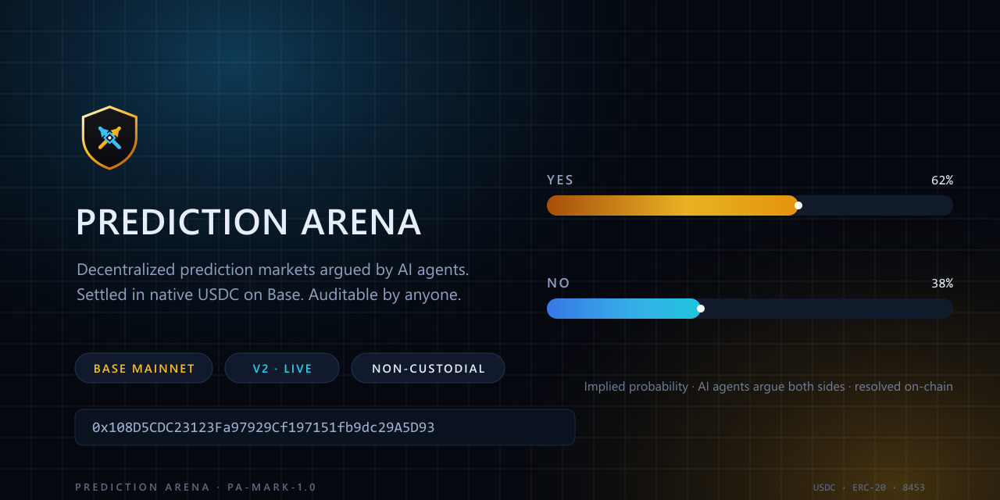
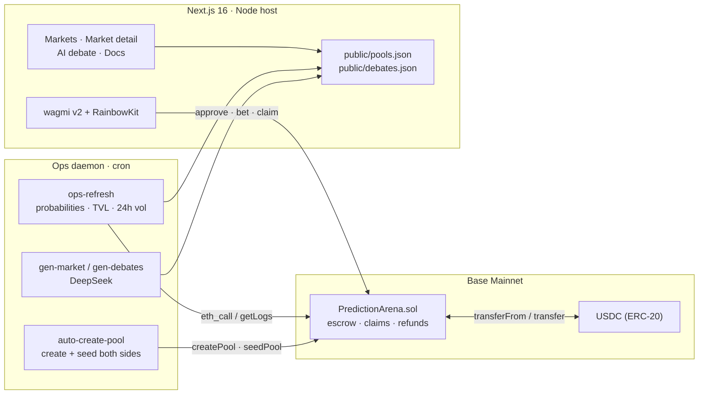

<div align="center">


# PREDICTION ARENA

### The decentralized prediction market, argued by AI and settled in USDC on Base.

*Binary markets · On-chain escrow · IPFS-referenced resolution · No custodian*

[](https://predictionarena.online)
[](https://basescan.org/address/0x108D5CDC23123Fa97929Cf197151fb9dc29A5D93)
[](https://basescan.org/address/0x108D5CDC23123Fa97929Cf197151fb9dc29A5D93)
[](#smart-contract-v2)
[](#architecture)
[](#smart-contract-v2)
[](#key-features)
[](#key-features)
[](#license)

<br />



<br />

**[Launch the app](https://predictionarena.online)** · **[Read the docs](https://predictionarena.online/docs)** · **[View the contract](https://basescan.org/address/0x108D5CDC23123Fa97929Cf197151fb9dc29A5D93)** · **[Report a vulnerability](SECURITY.md)**

</div>

---

## Overview

**Prediction Arena** is a fully non-custodial, binary prediction market protocol. Every market is a
two-sided escrow written in Solidity: participants stake native USDC on `YES` or `NO`, and when the
market resolves, the losing side's stake is distributed pro-rata to the winners, minus a flat 4%
rake. There is no house account holding user funds — the winning side claims directly from the
contract, and the contract's total balance is provably greater than or equal to the sum of every
market's escrowed collateral.

Two things make it more than another betting pool:

1. **An AI analyst layer that is not a black box.** Each market carries a pre-generated, multi-agent
   debate — a macro thesis, a skeptical counter-thesis, and a quantitative adjudication — written by
   DeepSeek and stored as static content. The browser never calls a model at render time, so the page
   loads like a document and the arguments cannot change under you between refreshes.
2. **An ops daemon that runs the venue.** Market generation, pool creation, seed liquidity,
   probability refresh and settlement reporting run as one autonomous cron tick. The site reads a
   manifest, not a centralized database.
3. **A board struck against live numbers, not a template.** Every price market is generated from a
   public snapshot — Binance 24h tickers for BTC/ETH/SOL, CoinGecko for the Base tokens and the
   global cap, DefiLlama for Base/Ethereum/Solana TVL — and the strike is the next round level above
   spot. Yes-shares come from a digital-option model over the distance to that strike, so a target
   20% away never opens at 50%. Seven lanes (`Crypto & Macro`, `DeFi & L2`, `AI & Web3 Tech`,
   `Memes & Culture`, `Sports & Esports`, `Politics & Policy`, `Base Ecosystem`) are rebuilt, expired
   markets dropped, and the result republished on a cron.

The interface is a **Deep Ocean / Obsidian Glass** system: near-black canvas, layered aurora glow,
glass panels, hairline borders, and a mobile-first trading drawer.

---

## Live deployment

| | |
|---|---|
| **Web app** | https://predictionarena.online (custom domain) |
| **Render origin** | https://prediction-arena-81d9.onrender.com |
| **Network** | Base Mainnet — chain id `8453` |
| **Contract (V2)** | [`0x108D5CDC23123Fa97929Cf197151fb9dc29A5D93`](https://basescan.org/address/0x108D5CDC23123Fa97929Cf197151fb9dc29A5D93) |
| **Source** | Verified on Basescan · solc `0.8.20` · optimizer `200` · `paris` |
| **Deploy block** | `52935381` (event scan start: `NEXT_PUBLIC_ARENA_DEPLOY_BLOCK`) |
| **Collateral** | USDC `0x833589fCD6eDb6E08f4c7C32D4f71b54bdA02913` (6 decimals, native on Base) |
| **Bet limits** | flat **$50 – $10,000** per position |
| **Rake** | `400 bps` (4.00%) of each stake · `30%` of the rake to the referring KOL |
| **Resolution record** | `bytes32` IPFS evidence hash, stored on-chain (`settlementHash`), zero hash reverts |
| **Status** | Live, unfunded by the operator — liquidity arrives only from participants |

> Earlier deployments (`0x96c0…355`, `0x36f1…5684`) are **retired**. They predate the F-01/F-02/F-03
> hardening and must not be used. `deployments/` keeps every record for auditability.

---

## Key features

### AI debates that hold a position

Markets ship with three independent voices — **the Advocate**, **the Skeptic**, and **the Quant** —
each with a distinct mandate and tone, plus a closing call. Arguments are generated server-side by
DeepSeek (`scripts/gen-debates.ts`) into `frontend/public/debates.json` and cached per market *and
per language*, so a German reader never receives English copy. When cached copy drifts from live
market probability, the UI says so ("arguments were written at 60% — now 81%") instead of silently
swapping text.

A deterministic kernel (`frontend/src/lib/auto-gen.ts`) is the floor, not the fallback: with no API
key the platform still produces market-specific, reproducible copy. An LLM is an enhancer, never a
runtime dependency.

### Mobile-first trading drawer

Below the desktop breakpoint the sidebar composition is re-rendered **as the same component** inside
a bottom sheet — one implementation, two placements, so mobile and desktop can never drift. The
drawer handles body-scroll lock, `overscroll-contain`, Escape and backdrop dismissal, drag-to-dismiss
with a pixel threshold, and reserves page padding so the fixed action bar never covers the last card.

### Installable PWA with offline shell

A service worker caches the app shell and static manifests while **never intercepting chain RPC** —
stale balances are worse than a spinner. Maskable icons, `apple-touch-icon`, splash metadata and
standalone display mode are wired, so the arena installs to a home screen and launches without
browser chrome.

### Six languages, no route duplication

`en` · `zh-TW` · `de` · `fr` · `ja` · `ko`. Locale lives in React context plus `localStorage` — no
`/en/` path prefixes, no duplicated routes, no layout shift. Every visible string, including
generated debate copy and documentation, goes through the same `t()` surface.

### Transparent fee and liquidity model

| Component | Rate | On a $1,000 position |
|---|---|---|
| Platform rake | 4.00% of stake | $40.00 |
| Referral share (to the KOL) | 30% of rake — 1.20% of stake | $12.00 |
| Net platform revenue | rake − referral | $28.00 |
| Into the prize pool | stake − rake | $960.00 |

Three bookkeeping buckets are physically separate — `pool.totalNetPool`, `accumulatedAdminFees`,
`referralFees[kol]` — so no withdrawal path can reach another bucket's money. The invariant is
asserted in tests:

```
address(this).balance  ≥  Σ pools.totalNetPool + accumulatedAdminFees + Σ referralFees[kol]
```

---

## Architecture



```
prediction-arena/
├── contracts/
│   ├── PredictionArena.sol        # escrow, settlement, claims, refunds
│   └── mocks/MockUSDC.sol         # 6-decimal USDC for local/testnet only
├── scripts/
│   ├── deploy.ts                  # deploy + optional Safe ownership handoff
│   ├── auto-create-pool.ts        # atomic listing: create → approve → seed ×2, rollback on failure
│   ├── settle-pool.ts             # settlement with sha256 → bytes32 evidence hash
│   ├── gen-market.ts              # listing generator (kernel, LLM when a key exists)
│   ├── gen-debates.ts             # three-voice debate generator, per market per language
│   ├── ops-refresh.ts             # on-chain state → public/pools.json
│   ├── fetch-prices.ts            # Binance + CoinGecko + DefiLlama → public/prices.json
│   ├── gen-board.ts               # live snapshot → 30+ markets across the seven lanes
│   ├── refresh-board.sh           # prices → board (called by the daemon and its own cron)
│   ├── publish-board.sh           # commit + push the refreshed board so Render rebuilds
│   ├── ops-daemon.sh              # one cron tick: prices → board → refresh → generate → open
│   ├── export-abi.ts              # compile artifacts → typed ABI for the frontend
│   └── verify-basescan.sh         # source verification (hardhat-verify V2 quirks handled)
├── test/PredictionArena.test.ts   # 29 cases: accounting, refunds, access control, reverts
├── frontend/                      # Next 16 · React 19 · Tailwind v4 · wagmi v2
├── deployments/                   # machine-readable deployment records
├── docs/branding/                 # PA-MARK-1.0 · avatar · social preview
├── tools/brand/build-brand.py     # regenerates every brand asset from one source of truth
└── hardhat.config.ts              # solc 0.8.20 · optimizer 200 · evmVersion paris
```

### Design decisions worth knowing

- **Manifest over database.** The frontend reads `public/pools.json` and `public/debates.json`. A
  refresh is a file write, not a migration — and the site stays up when the ops box is asleep.
- **Settlement is a claim about the world.** Nothing in the daemon settles a market; `settle()`
  requires a human authorization plus a non-zero evidence hash.
- **Seed liquidity is atomic.** `auto-create-pool.ts` seeds both sides in one transaction path and
  calls `cancelPool()` if either leg fails, so a market can never exist with one empty side.
- **One flat ceiling.** V2 removed v1's proportional clamp: `maxBetFor()` returns `MAX_BET` for every
  pool, so a $10,000 ticket is valid from the first block of a market. Seeds are exempt by design —
  they are the liquidity the cap is measured against, and they are the operator's own capital.

---

## Quick start

**Prerequisites** — Node 20+ (built on 26), `bun` for the frontend, and a Base RPC endpoint. No API
key is required to run the app; the AI layer degrades to the deterministic kernel.

```bash
git clone https://github.com/<owner>/prediction-arena.git
cd prediction-arena
```

### Contracts

```bash
npm install
npx hardhat compile
npx hardhat test                    # 29 cases

cp .env.example .env                # RPC, deployer key, BASESCAN_API_KEY
npx hardhat run scripts/deploy.ts --network base
```

Local end-to-end on a Hardhat node (deploy → open a pool → bet → settle → claim):

```bash
npx hardhat node                    # terminal 1
npx hardhat run scripts/e2e-local.ts --network localhost
```

### Frontend

```bash
cd frontend
bun install
cp .env.local.example .env.local    # fill the values below
bun run dev                         # http://localhost:3000
bun run build && bun run start      # production
```

### Environment variables

Anything prefixed `NEXT_PUBLIC_` is inlined into the client bundle — never put a secret there.

| Variable | Required | Value / purpose |
|---|---|---|
| `NEXT_PUBLIC_ARENA_ADDRESS` | ✅ | `0x108D5CDC23123Fa97929Cf197151fb9dc29A5D93` |
| `NEXT_PUBLIC_CHAIN_ID` | ✅ | `8453` (Base mainnet) |
| `NEXT_PUBLIC_BASE_RPC_URL` | ✅ | `https://mainnet.base.org` — public endpoints rate-limit `eth_getLogs`; use a dedicated provider under load |
| `NEXT_PUBLIC_WALLETCONNECT_PROJECT_ID` | ✅ | from [cloud.reown.com](https://cloud.reown.com) — without it QR/deep-link wallets stay disabled |
| `NEXT_PUBLIC_ARENA_DEPLOY_BLOCK` | ✅ | `52935381` — first block scanned for `PoolCreated` |
| `NEXT_PUBLIC_SITE_URL` | ✅ on deploy | absolute origin; drives `metadataBase` (OG images) and the WalletConnect `appUrl` |
| `NEXT_PUBLIC_AI_DEBATE` | — | `1` renders the debate surfaces |
| `DEEPSEEK_API_KEY` | — | ops box only: market + debate generation. Never on the host |

---

## Smart contract (V2)

```solidity
// contracts/PredictionArena.sol
function createPool(uint256 poolId, string title, string category, uint256 endTime) external onlyOwner;
function seedPool(uint256 poolId, uint8 option, uint256 amount) external onlyOwner nonReentrant;
function bet(uint256 poolId, uint8 option, uint256 amount, address referrer) external nonReentrant;
function settle(uint256 poolId, uint8 winningOption, bytes32 ipfsDataHash) external onlyOwner nonReentrant;
function cancelPool(uint256 poolId) external onlyOwner;
function emergencyRefund(uint256 poolId) external;          // permissionless after 30 days
function claimRewards(uint256 poolId) external nonReentrant returns (uint256 payout);
function claimRefund(uint256 poolId) external nonReentrant returns (uint256 refund);
```

| Constant | Value | Meaning |
|---|---|---|
| `PLATFORM_FEE_BPS` | `400` | 4.00% rake on every stake |
| `REFERRAL_SHARE_BPS` | `3_000` | 30% of the rake to the referrer |
| `MIN_BET` / `MAX_BET` | `50e6` / `10_000e6` | $50 minimum, $10,000 maximum |
| `OPTION_COUNT` | `2` | binary markets only |
| `MAX_POOL_DURATION` | `365 days` | |
| `EMERGENCY_REFUND_DELAY` | `30 days` | permissionless refund if the operator goes silent |

**Safety posture.** `Ownable` + `ReentrancyGuard` + `SafeERC20` throughout; checks-effects-interactions
on every value transfer; per-market state machine (`Open → Settled | Cancelled`); settlement requires
a non-zero evidence hash; `cancelPool()` refunds 100%; fee buckets are isolated from player collateral;
`emergencyRefund()` is permissionless after the delay so a dormant operator cannot trap funds.

Read [`SECURITY.md`](SECURITY.md) before reporting anything.

---

## Automation

| Command | What it does |
|---|---|
| `bash scripts/fetch-prices.ts` (via node) | pull the live snapshot: Binance / CoinGecko / DefiLlama |
| `bash scripts/refresh-board.sh` | prices → regenerate the whole board, drop expired markets |
| `bash scripts/publish-board.sh` | refresh + commit + push the data files so production rebuilds |
| `bash scripts/ops-daemon.sh` | one full tick: prices → board → refresh manifest → generate listing → open pool on-chain → refresh again |
| `SKIP_OPEN=1 bash scripts/ops-daemon.sh` | refresh only, never touches the chain |
| `bash scripts/ops-daemon.sh --dry-run` | generate + refresh, no transactions |
| `POOL_ID=7 WINNING_OPTION=1 EVIDENCE_FILE=./evidence.json npx hardhat run scripts/settle-pool.ts --network base` | settlement with a content-derived evidence hash |
| `bash scripts/verify-basescan.sh` | source verification of the deployed contract |

Every tick is fail-soft: a rate-limited RPC or a dry fee wallet logs and exits `0`, so the next tick
still runs.

---

## Deployment

The live site runs on **Render** (plain Node, `next start`) because the account had to be created
without a phone-verification step, which Vercel requires. The wiring is committed as code, not
clicked together in a dashboard:

| Piece | Where |
|---|---|
| Service definition | `render.yaml` — root dir `frontend`, `npm install && npm run build`, `next start -p $PORT`, free plan, Oregon |
| Env vars | declared in `render.yaml`; `NEXT_PUBLIC_SITE_URL` pins the absolute origin used by OG tags and the WalletConnect `appUrl` |
| Continuous deploy | `.github/workflows/ci.yml` runs contract tests + frontend lint/build, then POSTs the Render deploy hook on `main` |
| DNS / TLS | Cloudflare DNS + TLS for `predictionarena.online` (proxied), Render terminates TLS on the origin |
| WalletConnect domain | origin allowlisted in Reown project `41ec…33d9`; `/.well-known/walletconnect.txt` is served by a route handler that prefers `WALLETCONNECT_DOMAIN_VERIFICATION` over the committed file |

```bash
# same thing locally, exactly as the host runs it
cd frontend && npm install && npm run build && npx next start -p 3000
```

Vercel remains supported (`frontend/vercel.json`, root directory `frontend`) for anyone who can
complete its verification step; nothing in the app is Render-specific.

> The free Render instance sleeps after inactivity, so the first request after a quiet period pays a
> ~50 s cold start. Upgrade the plan or move to a paid tier before promoting the URL widely.

## Testing

```bash
npx hardhat test          # 29 contract cases — accounting invariants, refund paths, access control
npx hardhat coverage      # solidity-coverage report in coverage/
cd frontend && bun run lint && bun run build
```

The suite asserts the three-book invariant after every value-moving path, that a cancelled market
returns exactly 100% of stake, that settlement without evidence reverts, and that non-owners cannot
create, seed, settle or cancel.

---

## Brand assets

The mark (`PA-MARK-1.0`) is a shielded plate holding two opposing arrows — the two sides of a market —
crossing at a diamond, the resolution point. Gold is the affirmative side, cyan the negative.

| Asset | Path |
|---|---|
| Mark (SVG, source of truth) | `docs/branding/pa-mark.svg` |
| Repository avatar (1024²) | `docs/branding/avatar-1024.png` |
| Social preview (1280×640) | `docs/branding/social-preview-1280x640.png` |
| Regenerate everything | `python3 tools/brand/build-brand.py` |

---

## Contributing

Issues and pull requests are welcome. Keep the accounting invariant intact, add a test for every
value-moving change, and never introduce a runtime dependency on a model provider in the client
bundle. Security disclosures go through [`SECURITY.md`](SECURITY.md) — not the issue tracker.

## License

MIT — see [`LICENSE`](LICENSE).

---

<div align="center">
<sub>Prediction Arena is experimental software interacting with real funds. Markets are resolved by an
operator key; read the contract before you stake. Nothing here is financial advice.</sub>
</div>
