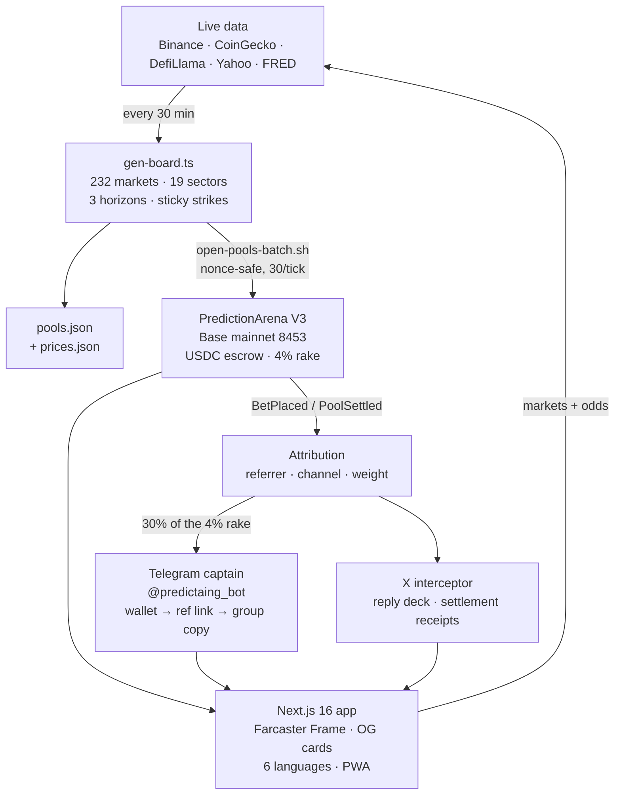
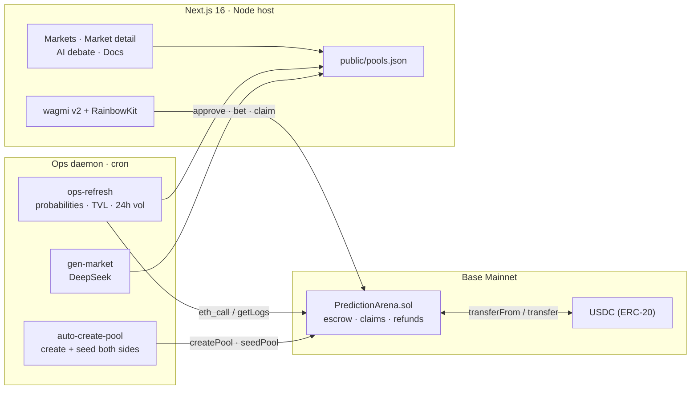

<div align="center">


# PREDICTION ARENA

### The decentralized prediction market, argued by AI and settled in USDC on Base.

> **An autonomous 24/7 Web3 prediction-market CGO agent** — market generation, on-chain pool
> creation, AI-drafted copy, referral attribution and settlement accounting all run on cron and
> GitHub Actions, on Base, **with zero human intervention between ticks**. The repo you are reading
> is the agent: there is no dashboard nobody checks and no spreadsheet behind it.

*Binary markets · On-chain escrow · IPFS-referenced resolution · No custodian · No human in the loop*

[](https://predictionarena.online)
[](https://basescan.org/address/0x961872d75ea6E7A2859B9b04C6C7B1C73CF510b5)
[](https://basescan.org/address/0x961872d75ea6E7A2859B9b04C6C7B1C73CF510b5)
[](#smart-contract-v2)
[](#architecture)
[](#smart-contract-v2)
[](#key-features)
[](#key-features)
[](#license)
[](#the-autonomous-cgo-agent)
[](#the-autonomous-cgo-agent)
[](#quick-start)
[](#the-board)
[](https://github.com/lulaxiao97-create/prediction-arena/stargazers)

<br />


<br />

**[Launch the app](https://predictionarena.online)** · **[Read the docs](https://predictionarena.online/docs)** · **[View the contract](https://basescan.org/address/0x961872d75ea6E7A2859B9b04C6C7B1C73CF510b5)** · **[Report a vulnerability](SECURITY.md)**

</div>

---

## The loop, end to end



*Every edge is a cron job or an on-chain event. Nothing in this diagram needs a human at 3am.*

## Quick start (60 seconds)

```bash
git clone https://github.com/lulaxiao97-create/prediction-arena
cd prediction-arena

# 1. the board, offline: live feeds → 232 markets with strikes and odds
export HTTPS_PROXY=http://127.0.0.1:7890      # optional, only if your egress needs it
node --experimental-strip-types scripts/fetch-prices.ts
node --experimental-strip-types scripts/gen-board.ts

# 2. the app
cd frontend && bun install && bun run dev     # http://localhost:3000

# 3. the money path (fork, no real funds)
cd .. && cp .env.example .env                 # PRIVATE_KEY / BASE_RPC_URL / ARENA_ADDRESS
bun run e2e:local                             # deploy → open pool → bet → settle, on anvil
```

`gen-board` refuses to write a board under 100 markets and refuses to invent a price: if the
snapshot is older than three hours it exits non-zero instead of shipping a number it cannot read.
That constraint is the product.


## Overview

**Prediction Arena** is a fully non-custodial, binary prediction market protocol. Every market is a
two-sided escrow written in Solidity: participants stake native USDC on `YES` or `NO`, and when the
market resolves, the losing side's stake is distributed pro-rata to the winners, minus a flat 4%
rake. There is no house account holding user funds — the winning side claims directly from the
contract, and the contract's total balance is provably greater than or equal to the sum of every
market's escrowed collateral.

Two things make it more than another betting pool:

1. **An AI analyst layer that is not a black box.** Each market carries a pre-generated, multi-agent
   debate — a macro thesis, a skeptical counter-thesis, and a quantitative adjudication — written by
   DeepSeek and stored as static content. The browser never calls a model at render time, so the page
   loads like a document and the arguments cannot change under you between refreshes.
2. **An ops daemon that runs the venue.** Market generation, pool creation, seed liquidity,
   probability refresh and settlement reporting run as one autonomous cron tick. The site reads a
   manifest, not a centralized database.
3. **A 150-market board struck against live numbers, not a template.** Every price market is
   generated from a public snapshot — Binance 24h tickers for 19 majors and memecoins, CoinGecko for
   the Base tokens and the global cap, DefiLlama for eight chains' TVL, Yahoo Finance for NVIDIA /
   Apple / the S&P / gold / WTI / DXY, and FRED for the 10-year, the 2s10s curve, the policy rate,
   CPI and unemployment — and the strike is the next round level above spot. Yes-shares come from a
   digital-option model over the distance to that strike, so a target 20% away never opens at 50%;
   the 24-hour rung uses a touch probability instead, because a print resolves it. Eight lanes
   (`Crypto & Macro`, `DeFi & L2`, `AI & Web3 Tech`, `Memes & Culture`, `Sports & Esports`,
   `Politics & Policy`, `Base Ecosystem`, `Macro & Economy`) are rebuilt on three horizons at once
   — 24h, 3–7 days, month- and quarter-end — so every day opens new markets and the long rungs keep
   accumulating liquidity. Expired markets are dropped and the result republished on a cron.

The interface is a **Deep Ocean / Obsidian Glass** system: near-black canvas, layered aurora glow,
glass panels, hairline borders, and a mobile-first trading drawer.

---

## The autonomous CGO agent

Most "AI growth" is a person with a Notion board. This is a repository that wakes up on its own,
reads the chain and the ticker, writes the copy, opens the pools, and attributes the money — then
proves it did, in `git log`.

```
┌───────────────────────────────────────────────────────────────────────────┐
│  GitHub Actions · 09:10 / 17:10 UTC                                       │
│  sync attribution → rank by tribal score → draft X / Farcaster / Telegram │
│  → post what it is allowed to post → commit the archive                   │
└───────────────┬───────────────────────────────────────────────────────────┘
                │  docs/campaigns/<YYYY-MM-DD>/index.json   (git = content log)
                ▼
┌─────────────────────────────────┐        ┌────────────────────────────────┐
│  WSL cron · every 30 min        │        │  Base mainnet · chain 8453     │
│  prices → 150 markets → strikes │        │  PredictionArena V3            │
│  open pools on-chain (:10/:40)  │◄──────►│  escrow · 4% rake · 30% ref    │
│  sync attribution → weights     │        └────────────────────────────────┘
└───────────────┬─────────────────┘                        ▲
                │  pools.json / prices.json                │ BetPlaced(ref, amount, cut)
                ▼                                          │
┌─────────────────────────────────┐        ┌───────────────┴────────────────┐
│  Next.js 16 on Render           │        │  /api/growth/summary           │
│  markets · Frames · PWA · i18n  │◄───────┤  6 × 1000-block scan, ~2.5 s    │
└─────────────────────────────────┘        └────────────────────────────────┘
```

### The six loops

| # | Loop | Trigger | Code | What breaks without it |
|---|---|---|---|---|
| 1 | **Board rebuild** — prices → 150 markets → strikes recomputed | cron `*/30` | `scripts/refresh-board.sh` → `gen-board.ts` | The site keeps serving yesterday's strikes, and a market that already resolved stays listed |
| 2 | **Pool creation** — every new market opened on Base, 30 per tick, nonce-safe parallel | cron `:10,:40` | `scripts/open-pools-batch.sh` | A card exists that cannot accept a bet (`PoolNotFound`) |
| 3 | **Publish** — data committed, pushed, CI → Render | cron `:05` (45-min throttle, retry+rebase) | `scripts/publish-board.sh` | Local data changes never reach the origin |
| 4 | **Content factory** — ranking + copy in three voices, archived | GH Actions 2×/day | `scripts/auto-market.ts` | The channels go quiet; nobody remembers which numbers were live |
| 5 | **Attribution** — which tribe's market actually took USDC | cron `*/30` → `docs/campaigns/attribution.json` | `scripts/sync-attribution.ts` | Market selection stays a hand-tuned guess forever |
| 6 | **Distribution** — one paste-ready block per channel | human, on demand | `scripts/campaign-digest.ts` | Copy exists but nobody can move it into a chat in 5 seconds |

### The parts worth stealing

- **OAuth 1.0a HMAC-SHA1 signed by hand** (`scripts/auto-market.ts`): X still requires a
  user-context credential to post, and the only one a solo operator can mint without a browser
  round-trip is the four-part key set. The signing rules that bite (`!*'()` percent-encoding,
  JSON bodies contributing no parameters) are implemented from the RFC, not from a library.
- **Failure is classified, not swallowed**: `sent` / `skipped: <reason>` / `failed <status>`, with
  **401 = bad signature → 402 = billing → 403 Unsupported = wrong credential type**. A 402 is a
  billing problem, and the code says so instead of pretending the tweet went out.
- **Attribution closes into selection**: `/api/growth/summary` → `sync-attribution.ts` →
  `tribalScore` gets a capped **+2** bonus for the tribe whose markets actually took the most USDC.
  No file, a stale file, or zero bets means zero bonus — the prior stays, and nothing is invented.
- **A frame that reports its own render time**: `/api/frame` answers with `x-frame-ms`,
  `x-frame-cache` and `server-timing`. Measured in production: **0.03–3.5 ms in the handler**
  against **0.6–1.3 s wall time** — i.e. the card is not the bottleneck, the network is, and now
  that is a number instead of an opinion.
- **Copy budgets are enforced per platform**: X at 280 with URLs counted as 23, Farcaster at 320
  with links at full length, Telegram unbounded — one market, three sizes, first draft that fits
  wins, so a long title degrades instead of getting truncated mid-word.
- **Every claim on this page is a `curl` away** (below). If a number here stops being true, that is
  a bug, not marketing drift.
- **The picture is rendered, not designed.** `scripts/generate-marketing-image.ts` screenshots a
  1200×675 HTML card in the same Chromium the e2e suite uses, with a QR code of the *tracked* link.
  Every number on it comes from the archived snapshot the copy was written from, so the tweet and
  the image can never disagree — and when the card is older than the board it says `AS POSTED`
  instead of `LIVE`.
- **The captain bot is a pure function with a transport around it.** `scripts/telegram-bot.ts`
  answers `/start captain` → wallet address → the captain's own `?ref=<address>` link plus a
  copy-paste group template. The conversation is tested offline (`--self-test`, no token), because
  a bot that "should work" is not a deliverable.

### Verify the agent in 60 seconds — no API key

```bash
# 1. the live board is real market data, timestamped by source
curl -s https://predictionarena.online/prices.json | head -c 400

# 2. the frame says how long its own render took (handler ms, not network ms)
curl -s -o /dev/null -D - https://predictionarena.online/api/frame?id=700011 | grep -i x-frame

# 3. on-chain attribution, straight off Base logs
curl -s "https://predictionarena.online/api/growth/summary?chunks=6" | head -c 400

# 4. the content trail: every post the agent drafted, with the numbers it had at the time
curl -s https://raw.githubusercontent.com/lulaxiao97-create/prediction-arena/main/docs/campaigns/$(date -u +%F)/index.json | head -c 400
```

### What the agent cannot do (yet) — stated, not hidden

- **X posting is switched off by billing, not by code.** The account sits at `402 credits depleted`;
  the signed request is correct and the copy is archived daily. Distribution is therefore **manual
  and zero-cost by design**: `bun run campaign:digest --remote` prints paste-ready blocks for X,
  Farcaster and Telegram. Telegram itself is fully automated.
- **Zero on-chain bets so far.** The pools exist (`getPool(700001..700038)` → `Open`), the referrer
  path is wired end to end, and `volumeUsdc` reads `0`. A growth dashboard that shows a fabricated
  first trader is worse than an empty one, so it shows `0`.
- **Channel mix is not derivable from chain logs.** The contract's referrer must be an address;
  `utm_*` lives on the landing page. The panel says this explicitly instead of inventing a split.
- **Business math is unflattering and left visible**: 4% rake, so $10k/month = $250k of monthly
  volume ≈ 333 wallets with real capital. The $1 trial tickets validate the funnel; they cannot
  fund that number.

---

## Live deployment

| | |
|---|---|
| **Web app** | https://predictionarena.online (custom domain) |
| **Render origin** | https://prediction-arena-81d9.onrender.com |
| **Network** | Base Mainnet — chain id `8453` |
| **Contract (V3)** | [`0x961872d75ea6E7A2859B9b04C6C7B1C73CF510b5`](https://basescan.org/address/0x961872d75ea6E7A2859B9b04C6C7B1C73CF510b5) |
| **Source** | Verified on Basescan · solc `0.8.20` · optimizer `200` · `paris` |
| **Deploy block** | `52935381` (event scan start: `NEXT_PUBLIC_ARENA_DEPLOY_BLOCK`) |
| **Collateral** | USDC `0x833589fCD6eDb6E08f4c7C32D4f71b54bdA02913` (6 decimals, native on Base) |
| **Bet limits** | flat **$50 – $10,000** per position |
| **Rake** | `400 bps` (4.00%) of each stake · `30%` of the rake to the referring KOL |
| **Resolution record** | `bytes32` IPFS evidence hash, stored on-chain (`settlementHash`), zero hash reverts |
| **Status** | Live, unfunded by the operator — liquidity arrives only from participants |

> Earlier deployments (`0x96c0…355`, `0x36f1…5684`) are **retired**. They predate the F-01/F-02/F-03
> hardening and must not be used. `deployments/` keeps every record for auditability.

---

## Key features

### AI debates that hold a position

Every market carries a six-round debate between **Onchain Detective**, **Macro Hawk** and
**Meme Master**: the bull opens with the market's own numbers, the bear answers with the live odds,
each rebuts, the third desk calls the price, and the higher-conviction side closes with the multiple
it is paying.

The text is generated from the market itself (`frontend/src/lib/debate.ts`) — subject, strike,
expiry, current YES/NO split and fee-net multiples — in all six locales, each with its own natively
written copy deck rather than a translation of the English one. Selection is hashed from the pool
id, so the same market prints the same argument on every render, on the server and in the browser.

No model is called at runtime and no debate text is shipped as a static file: the engine is pure,
deterministic and free per view. An LLM is an enhancer for *market copy*, never a dependency of the
debate.

### Mobile-first trading drawer

Below the desktop breakpoint the sidebar composition is re-rendered **as the same component** inside
a bottom sheet — one implementation, two placements, so mobile and desktop can never drift. The
drawer handles body-scroll lock, `overscroll-contain`, Escape and backdrop dismissal, drag-to-dismiss
with a pixel threshold, and reserves page padding so the fixed action bar never covers the last card.

### Installable PWA with offline shell

A service worker caches the app shell and static manifests while **never intercepting chain RPC** —
stale balances are worse than a spinner. Maskable icons, `apple-touch-icon`, splash metadata and
standalone display mode are wired, so the arena installs to a home screen and launches without
browser chrome.

### Six languages, no route duplication

`en` · `zh-TW` · `de` · `fr` · `ja` · `ko`. Locale lives in React context plus `localStorage` — no
`/en/` path prefixes, no duplicated routes, no layout shift. Every visible string, including
generated debate copy and documentation, goes through the same `t()` surface.

### Operator console

`/admin` is an internal console for the desk, not a user surface: monetisation counters (HypeLab
auctions, 200 vs 204 fill rate, estimated revenue at a configurable eCPM), the USDC payout queue with
one-click copy of the transfer payload, a settlement form that builds `settle(poolId, outcome, digest)`
from a pasted evidence bundle, and the ledger audit trail of ad credits, ticket redemptions and cashout
requests.

Access is an allowlisted address **plus** an EIP-191 signature over a timestamped message that the
metrics API re-verifies server-side. The console deliberately cannot move money on its own: settlement
and pausing are wallet transactions, and the contract's `onlyOwner` is the real check.

### Real liquidity beats demo numbers

A card only shows the deterministic demo depth while the pool is empty on the contract. As soon as
`totalNetPool > 0` the card, the hero banner, the detail page and the AI copy all switch to the real
stake, and the depth chip flips from `DEMO DEPTH` to `ON-CHAIN POOL`. Traders and 24h turnover are not
indexed on-chain, so live pools render `—` there rather than inventing traffic next to real money.

### Transparent fee and liquidity model

| Component | Rate | On a $1,000 position |
|---|---|---|
| Platform rake | 4.00% of stake | $40.00 |
| Referral share (to the KOL) | 30% of rake — 1.20% of stake | $12.00 |
| Net platform revenue | rake − referral | $28.00 |
| Into the prize pool | stake − rake | $960.00 |

Three bookkeeping buckets are physically separate — `pool.totalNetPool`, `accumulatedAdminFees`,
`referralFees[kol]` — so no withdrawal path can reach another bucket's money. The invariant is
asserted in tests:

```
address(this).balance  ≥  Σ pools.totalNetPool + accumulatedAdminFees + Σ referralFees[kol]
```

---

## Architecture



```
prediction-arena/
├── contracts/
│   ├── PredictionArena.sol        # escrow, settlement, claims, refunds
│   └── mocks/MockUSDC.sol         # 6-decimal USDC for local/testnet only
├── scripts/
│   ├── deploy.ts                  # deploy + optional Safe ownership handoff
│   ├── auto-create-pool.ts        # atomic listing: create → approve → seed ×2, rollback on failure
│   ├── settle-pool.ts             # settlement with sha256 → bytes32 evidence hash
│   ├── gen-market.ts              # listing generator (kernel, LLM when a key exists)
│   ├── ops-refresh.ts             # on-chain state → public/pools.json
│   ├── fetch-prices.ts            # Binance + CoinGecko + DefiLlama → public/prices.json
│   ├── gen-board.ts               # live snapshot → 30+ markets across the seven lanes
│   ├── refresh-board.sh           # prices → board (called by the daemon and its own cron)
│   ├── publish-board.sh           # commit + push the refreshed board so Render rebuilds
│   ├── ops-daemon.sh              # one cron tick: prices → board → refresh → generate → open
│   ├── export-abi.ts              # compile artifacts → typed ABI for the frontend
│   └── verify-basescan.sh         # source verification (hardhat-verify 2.x quirks handled)
├── test/PredictionArena.test.ts   # 29 cases: accounting, refunds, access control, reverts
├── frontend/                      # Next 16 · React 19 · Tailwind v4 · wagmi v2
├── deployments/                   # machine-readable deployment records
├── docs/branding/                 # PA-MARK-1.0 · avatar · social preview
├── tools/brand/build-brand.py     # regenerates every brand asset from one source of truth
└── hardhat.config.ts              # solc 0.8.20 · optimizer 200 · evmVersion paris
```

### Design decisions worth knowing

- **Manifest over database.** The frontend reads `public/pools.json`. A refresh is a file write, not
  a migration — and the site stays up when the ops box is asleep. Debates are not stored at all:
  `lib/debate.ts` derives them from the pool, so there is no cache to invalidate.
- **Settlement is a claim about the world.** Nothing in the daemon settles a market; `settle()`
  requires a human authorization plus a non-zero evidence hash.
- **Seed liquidity is atomic.** `auto-create-pool.ts` seeds both sides in one transaction path and
  calls `cancelPool()` if either leg fails, so a market can never exist with one empty side.
- **One flat ceiling.** v2 removed v1's proportional clamp (v3 keeps it): `maxBetFor()` returns `MAX_BET` for every
  pool, so a $10,000 ticket is valid from the first block of a market. Seeds are exempt by design —
  they are the liquidity the cap is measured against, and they are the operator's own capital.

---

## Quick start

**Prerequisites** — Node 20+ (built on 26), `bun` for the frontend, and a Base RPC endpoint. No API
key is required to run the app; the AI layer degrades to the deterministic kernel.

```bash
git clone https://github.com/<owner>/prediction-arena.git
cd prediction-arena
```

### Contracts

```bash
npm install
npx hardhat compile
npx hardhat test                    # 29 cases

cp .env.example .env                # RPC, deployer key, BASESCAN_API_KEY
npx hardhat run scripts/deploy.ts --network base
```

Local end-to-end on a Hardhat node (deploy → open a pool → bet → settle → claim):

```bash
npx hardhat node                    # terminal 1
npx hardhat run scripts/e2e-local.ts --network localhost
```

### Frontend

```bash
cd frontend
bun install
cp .env.local.example .env.local    # fill the values below
bun run dev                         # http://localhost:3000
bun run build && bun run start      # production
```

### Environment variables

Anything prefixed `NEXT_PUBLIC_` is inlined into the client bundle — never put a secret there.

| Variable | Required | Value / purpose |
|---|---|---|
| `NEXT_PUBLIC_ARENA_ADDRESS` | ✅ | `0x961872d75ea6E7A2859B9b04C6C7B1C73CF510b5` |
| `NEXT_PUBLIC_CHAIN_ID` | ✅ | `8453` (Base mainnet) |
| `NEXT_PUBLIC_BASE_RPC_URL` | ✅ | `https://mainnet.base.org` — public endpoints rate-limit `eth_getLogs`; use a dedicated provider under load |
| `NEXT_PUBLIC_WALLETCONNECT_PROJECT_ID` | ✅ | from [cloud.reown.com](https://cloud.reown.com) — without it QR/deep-link wallets stay disabled |
| `NEXT_PUBLIC_ARENA_DEPLOY_BLOCK` | ✅ | `52935381` — first block scanned for `PoolCreated` |
| `NEXT_PUBLIC_SITE_URL` | ✅ on deploy | absolute origin; drives `metadataBase` (OG images) and the WalletConnect `appUrl` |
| `NEXT_PUBLIC_AI_DEBATE` | — | `1` renders the debate surfaces |
| `DEEPSEEK_API_KEY` | — | ops box only: market + debate generation. Never on the host |

---

## Smart contract (V3)

```solidity
// contracts/PredictionArena.sol
function createPool(uint256 poolId, string title, string category, uint256 endTime) external onlyOwner;
function seedPool(uint256 poolId, uint8 option, uint256 amount) external onlyOwner nonReentrant;
function bet(uint256 poolId, uint8 option, uint256 amount, address referrer) external nonReentrant;
function settle(uint256 poolId, uint8 winningOption, bytes32 ipfsDataHash) external onlyOwner nonReentrant;
function cancelPool(uint256 poolId) external onlyOwner;
function emergencyRefund(uint256 poolId) external;          // permissionless after 30 days
function claimRewards(uint256 poolId) external nonReentrant returns (uint256 payout);
function claimRefund(uint256 poolId) external nonReentrant returns (uint256 refund);
function pause() external onlyOwner;                         // gates bet() only
function unpause() external onlyOwner;
function getPools(uint256[] calldata ids) external view returns (PoolView[] memory);  // one eth_call
```

| Constant | Value | Meaning |
|---|---|---|
| `PLATFORM_FEE_BPS` | `400` | 4.00% rake on every stake |
| `REFERRAL_SHARE_BPS` | `3_000` | 30% of the rake to the referrer |
| `MIN_BET` / `MAX_BET` | `50e6` / `10_000e6` | $50 minimum, $10,000 maximum |
| `OPTION_COUNT` | `2` | binary markets only |
| `MAX_POOL_DURATION` | `365 days` | |
| `EMERGENCY_REFUND_DELAY` | `30 days` | permissionless refund if the operator goes silent |

**Safety posture.** `Ownable` + `ReentrancyGuard` + `SafeERC20` throughout; checks-effects-interactions
on every value transfer; per-market state machine (`Open → Settled | Cancelled`); settlement requires
a non-zero evidence hash; `cancelPool()` refunds 100%; fee buckets are isolated from player collateral;
`emergencyRefund()` is permissionless after the delay so a dormant operator cannot trap funds.
The pause switch gates **betting only** — `claimRewards()` and `claimRefund()` are never pausable, so a
paused arena can stop taking new risk but can never stop a user from leaving with money that is
already theirs.

Read [`SECURITY.md`](SECURITY.md) before reporting anything.

---

## Automation

| Command | What it does |
|---|---|
| `bash scripts/fetch-prices.ts` (via node) | pull the live snapshot: Binance / CoinGecko / DefiLlama |
| `bash scripts/refresh-board.sh` | prices → regenerate the whole board, drop expired markets |
| `bash scripts/publish-board.sh` | refresh + commit + push the data files so production rebuilds |
| `bash scripts/ops-daemon.sh` | one full tick: prices → board → refresh manifest → generate listing → open pool on-chain → refresh again |
| `SKIP_OPEN=1 bash scripts/ops-daemon.sh` | refresh only, never touches the chain |
| `bash scripts/ops-daemon.sh --dry-run` | generate + refresh, no transactions |
| `POOL_ID=7 WINNING_OPTION=1 EVIDENCE_FILE=./evidence.json npx hardhat run scripts/settle-pool.ts --network base` | settlement with a content-derived evidence hash |
| `bash scripts/verify-basescan.sh` | source verification of the deployed contract |
| `bun run auto:market --pick=tribal --limit=1 --write` | rank markets by tribal score, draft X / Farcaster / Telegram copy, archive it under `docs/campaigns/` |
| `bun run auto:market --send` | same, and publish to whatever channel has live credentials (Telegram now, X when the account has credit) |
| `bun run sync:attribution` | read `/api/growth/summary`, aggregate USDC per tribe, write `docs/campaigns/attribution.json` for the picker |
| `bun run campaign:digest --remote` | pull the newest archived campaign from GitHub and print paste-ready blocks per channel |
| `bun run campaign:digest --md` | the same archive as a weekly markdown calendar |
| `bun run push:marketing` | write the day's paste-ready pack (tweet, reply deck, captain pitch) to the desktop |
| `bun scripts/generate-marketing-image.ts --market=700011` | render the 1200×675 OG card (and its QR) for one market |
| `bun scripts/telegram-bot.ts --self-test` | exercise the captain conversation offline, no token needed |
| `bash scripts/start-telegram-bot.sh` | start / keep alive the captain bot (idempotent, no-ops without a token) |

Every tick is fail-soft: a rate-limited RPC or a dry fee wallet logs and exits `0`, so the next tick
still runs.

---

## Deployment

The live site runs on **Render** (plain Node, `next start`) because the account had to be created
without a phone-verification step, which Vercel requires. The wiring is committed as code, not
clicked together in a dashboard:

| Piece | Where |
|---|---|
| Service definition | `render.yaml` — root dir `frontend`, `npm install && npm run build`, `next start -p $PORT`, free plan, Oregon |
| Env vars | declared in `render.yaml`; `NEXT_PUBLIC_SITE_URL` pins the absolute origin used by OG tags and the WalletConnect `appUrl` |
| Continuous deploy | `.github/workflows/ci.yml` runs contract tests + frontend lint/build, then POSTs the Render deploy hook on `main` |
| DNS / TLS | Cloudflare DNS + TLS for `predictionarena.online` (proxied), Render terminates TLS on the origin |
| WalletConnect domain | origin allowlisted in Reown project `41ec…33d9`; `/.well-known/walletconnect.txt` is served by a route handler that prefers `WALLETCONNECT_DOMAIN_VERIFICATION` over the committed file |

```bash
# same thing locally, exactly as the host runs it
cd frontend && npm install && npm run build && npx next start -p 3000
```

Vercel remains supported (`frontend/vercel.json`, root directory `frontend`) for anyone who can
complete its verification step; nothing in the app is Render-specific.

> The free Render instance sleeps after inactivity, so the first request after a quiet period pays a
> ~50 s cold start. Upgrade the plan or move to a paid tier before promoting the URL widely.

## Testing

```bash
npx hardhat test          # 35 contract cases — invariants, refund paths, access control, pause, batch read
npx hardhat coverage      # solidity-coverage report in coverage/
cd frontend && bun run lint && bun run build
cd frontend && bun run test:e2e   # Playwright: wallet → market → bet → three-stage rail
```

The suite asserts the three-book invariant after every value-moving path, that a cancelled market
returns exactly 100% of stake, that settlement without evidence reverts, that non-owners cannot
create, seed, settle or cancel, that a paused arena still pays winners and refunds, and that
`getPools()` returns exactly what N `getPool()` calls would.

The Playwright smoke runs against the production build with a mocked EIP-1193 wallet and a stubbed
Base RPC: a **zero-balance** wallet connects, opens a market, presses submit, and the three-stage
progress rail has to walk Approve → Sign → Confirmed. It also asserts that no YES/NO button renders
without its multiple — the two regressions that reached production once already.

---

## Brand assets

The mark (`PA-MARK-1.0`) is a shielded plate holding two opposing arrows — the two sides of a market —
crossing at a diamond, the resolution point. Gold is the affirmative side, cyan the negative.

| Asset | Path |
|---|---|
| Mark (SVG, source of truth) | `docs/branding/pa-mark.svg` |
| Repository avatar (1024²) | `docs/branding/avatar-1024.png` |
| Social preview (1280×640) | `docs/branding/social-preview-1280x640.png` |
| Regenerate everything | `python3 tools/brand/build-brand.py` |

---

## Build in public

This repo is meant to be read, not just used. If you are here to see how far an autonomous agent can
run a real venue, the interesting parts are:

- `scripts/auto-market.ts` — a content factory with hand-rolled OAuth 1.0a, per-platform budgets and
  a "no invented numbers" rule enforced by reading the manifest instead of typing a number;
- `scripts/sync-attribution.ts` → `tribalScore` — attribution data feeding market selection, capped
  so one hot market cannot monopolise the channel;
- `scripts/publish-board.sh` — a cron that survives a second writer on `main` (retry → fetch →
  `rebase --autostash`), because "push failed" silently killing a loop for two ticks is how these
  systems actually die;
- `frontend/src/app/api/frame/route.ts` — a Farcaster frame that measures itself (`x-frame-ms`) so
  latency claims stay honest;
- `frontend/src/app/api/growth/summary/route.ts` — referral attribution read straight from
  `BetPlaced` logs, including what the chain *cannot* tell you.

**If this is useful to you, star the repo** — stars are the only budget this project has for
distribution. The build log, including the parts that are still broken, is the `docs/campaigns/`
archive and the commit history (every decision is a commit message, not a changelog entry).

Three ways to be useful beyond a star:

1. **Take a side on a market** — the pools are open, and every bet is `bet(poolId, option, amount,
   referrer)` on a verified contract.
2. **Share the market you disagree with** — every link carries `?ref=`; a referred position shows up
   in `/admin` attribution within a block.
3. **Break it** — the invariants are listed in `SECURITY.md`, and a reproducible failure with a PoC
   is worth more than a hundred suggestions.

## For Hacker News / Product Hunt

**Show HN: a 100% autonomous Web3 growth agent running a real prediction market on Base**

Most "AI agent" repos are a prompt, a cron and a screenshot. This one moves money-shaped state:
it rebuilds 150 markets from live feeds every 30 minutes, opens the corresponding pools on Base
mainnet, writes the day's copy in three voices, posts what it is allowed to post, and reads the
resulting referral volume straight off `BetPlaced` logs to decide what to feature next. Between
ticks there is no human. The interesting part is not that it generates text — it is that the
pipeline **refuses to emit a number it cannot read**, and that every claim is one `curl` away.

Three things a hacker will actually enjoy here:

1. **OAuth 1.0a written from the RFC**, because X only grants posting rights to a user-context
   credential and a solo operator has no browser round-trip budget. The failure taxonomy is
   explicit: `401` signature, `402` billing, `403 Unsupported` wrong credential type.
2. **A market picker that learns from money.** Referral volume per tribe flows back into the
   `tribalScore` used to choose the day's market — capped at +2, additive only, and zero when
   there is no on-chain signal. Hand-tuned priors until the chain speaks.
3. **Cron that survives a second writer.** The content bot and the board publisher both commit to
   `main`; the publisher retries with `fetch → rebase --autostash → push` instead of dying
   silently for two ticks (which is exactly what happened before it was fixed).

**Honest state, as of this commit:** the X account is at `402 credits depleted`, so distribution is
manual and zero-cost by design (`bun run push:marketing` writes a paste-ready pack to the desktop);
on-chain bets are `0`, so the attribution loop is wired but unproven; the board's liquidity figures
are demo-priced while the pools themselves are real and empty. The README says this out loud
because a growth agent that lies about its own numbers is a liability, not a product.

**Try it in 30 seconds** (no key, no wallet): `curl -s -o /dev/null -D - https://predictionarena.online/api/frame?id=700011 | grep -i x-frame`
→ the frame reports its own render time (`0.03–3.5 ms` in the handler against `0.6–1.3 s` end to
end, i.e. the card is not the bottleneck and now that is measurable).

**What I would like from you:** tear apart the referral accounting
(`contracts/`, `lib/rewards.ts`), tell me which part of the agent is theatre, and star the repo if
the autopilot is worth watching. The build log — including the parts still broken — is the commit
history.

## Contributing

Issues and pull requests are welcome. Keep the accounting invariant intact, add a test for every
value-moving change, and never introduce a runtime dependency on a model provider in the client
bundle. Security disclosures go through [`SECURITY.md`](SECURITY.md) — not the issue tracker.

## License

MIT — see [`LICENSE`](LICENSE).

---

<div align="center">
<sub>Prediction Arena is experimental software interacting with real funds. Markets are resolved by an
operator key; read the contract before you stake. Nothing here is financial advice.</sub>
</div>
